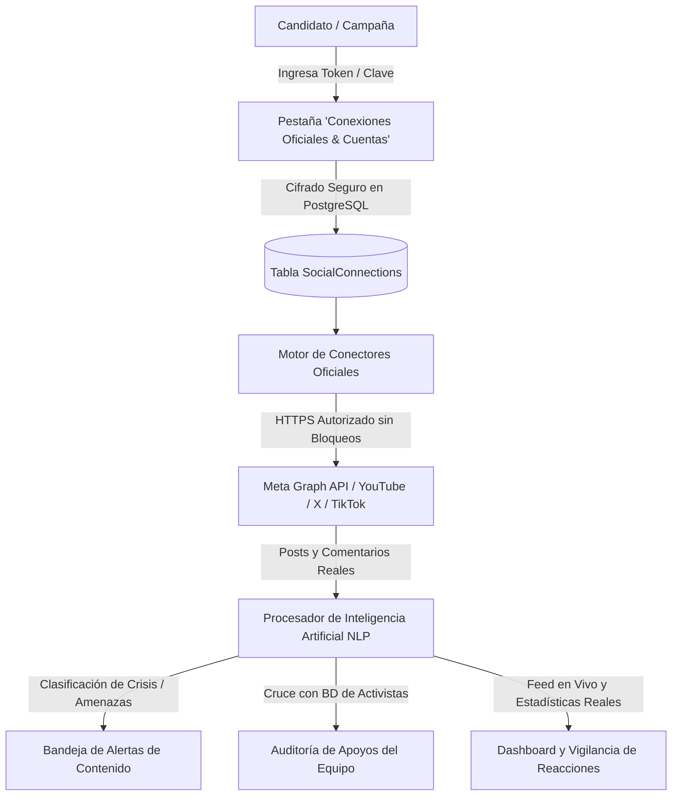

# INSTRUCTIVO OFICIAL: INTEGRACIÓN Y ADAPTACIÓN DE CUENTAS CON APIS OFICIALES
## SISTEMA ELECTORAL — MÓDULO DE MONITOREO REAL DE REDES SOCIALES

Este documento es la guía técnica y operativa oficial para vincular y sincronizar las cuentas de redes sociales de la campaña electoral (**Instagram, Facebook, YouTube, X/Twitter y TikTok**) mediante sus APIs oficiales, garantizando cero bloqueos de IP, seguridad jurídica y extracción de publicaciones y comentarios reales con análisis de Inteligencia Artificial.

---

## 1. ARQUITECTURA DE CONEXIÓN DEL SISTEMA

El sistema cuenta con un motor de conectores oficiales (`server/services/socialConnectors`) que interactúa directamente con los servidores de cada plataforma mediante protocolos autorizados:

### Principales Beneficios de la Integración por API:
1. **Blindaje de IP:** Tu servidor (`80.241.212.9`) queda registrado como cliente legítimo. Meta, Google y TikTok no bloquean la conexión.
2. **Datos 100% Reales:** Extracción completa de textos, fechas, enlaces multimedia, recuentos de comentarios y reacciones.
3. **Cero Simulación:** Prohibición estricta de métricas o comentarios falsos.
4. **Clasificación Automática con IA:** Detección en tiempo real de amenazas, insultos, spam y preguntas ciudadanas.

---

## 2. GUÍA PASO A PASO POR PLATAFORMA

---

### A. META (INSTAGRAM PROFESIONAL Y PÁGINA DE FACEBOOK)

Meta agrupa tanto a Facebook como a Instagram bajo la **Meta Graph API**.

#### Requisitos Previos:
1. **Instagram Profesional:** La cuenta de Instagram del candidato (ejemplo: `@diegofranariza`) debe ser de tipo **Profesional** (Creador o Negocio).  
   * *Cómo verificarlo:* En la app de Instagram del celular > **Configuración** > **Tipo de cuenta y herramientas** > Seleccionar *"Cambiar a cuenta profesional"*.
2. **Página de Facebook Vinculada:** La cuenta de Instagram debe estar vinculada a la Página de Facebook oficial de la campaña.

#### Procedimiento para Obtener el Token Oficial:
1. Ingresa al portal oficial de desarrolladores: **[https://developers.facebook.com/](https://developers.facebook.com/)** e inicia sesión con la cuenta de Facebook que administra la Página de la campaña.
2. En la esquina superior derecha, haz clic en **"Mis Apps"** > **"Crear app"**.
3. Selecciona el tipo de caso de uso: **"Otro"** > Siguiente > Tipo de app: **"Empresa / Negocio"** (*Business*).
4. Asigna un nombre a la aplicación (ejemplo: `Monitoreo Campaña Diego Ariza`) e ingresa el correo de contacto.
5. Una vez creada la app, en el menú superior ve a **Herramientas** > **Explorador de la Graph API** (*Graph API Explorer*):  
   🔗 Directo: [https://developers.facebook.com/tools/explorer/](https://developers.facebook.com/tools/explorer/)
6. En el panel derecho del Explorador:
   * **Meta App:** Selecciona la app recién creada.
   * **Usuario o página:** Selecciona **"Obtener token de acceso de la página"** (*Get Page Access Token*) y elige la página de la campaña.
   * **Permisos (Permissions):** Haz clic en *"Add a Permission"* y agrega:
     * `pages_show_list`
     * `pages_read_engagement`
     * `pages_read_user_content`
     * `instagram_basic`
     * `instagram_manage_comments`
7. Haz clic en el botón azul **"Generate Access Token"** y acepta los permisos en la ventana emergente.
8. Copia la cadena alfanumérica larga que aparece en la casilla **Access Token**.

#### Cómo Ingresarlo en el Sistema:
1. En tu Sistema Electoral, ve a la pestaña inferior: **`🔌 CONEXIONES OFICIALES & CUENTAS`**.
2. En la tarjeta de **Meta (Facebook & Instagram)**, haz clic en el botón **"Configurar Credenciales"**.
3. Pega el Token en el campo **Access Token** y guarda.
4. Presiona **"Probar Conexión"**. El sistema mostrará un indicador verde de conexión exitosa.

---

### B. GOOGLE CLOUD (YOUTUBE DATA API V3)

YouTube es la plataforma más rápida de conectar y su API oficial es **100% gratuita** con una cuota diaria de 10,000 unidades (suficiente para sincronizar cientos de videos y miles de comentarios al día).

#### Procedimiento para Obtener la API Key:
1. Ingresa a **[https://console.cloud.google.com/](https://console.cloud.google.com/)** con cualquier cuenta de Google/Gmail.
2. En la barra superior, haz clic en el selector de proyectos y presiona **"Nuevo proyecto"** (ejemplo: `Sistema Electoral`).
3. En el menú lateral izquierdo (icono de 3 líneas), ve a **APIs y servicios** > **Biblioteca**.
4. En el buscador escribe **"YouTube Data API v3"**, selecciónala y haz clic en **"Habilitar"**.
5. Ve a **APIs y servicios** > **Credenciales**.
6. En la parte superior presiona **"+ Crear credenciales"** > selecciona **"Clave de API"** (*API Key*).
7. Aparecerá una ventana con tu clave (ejemplo: `AIzaSyD-xxxxxxxxxxxxxxxxxxxxx`). Cópiala.

#### Cómo Ingresarlo en el Sistema:
1. En el Sistema Electoral, pestaña **`🔌 CONEXIONES OFICIALES & CUENTAS`**.
2. En la tarjeta de **YouTube**, haz clic en **"Configurar Credenciales"**.
3. Pega tu Clave de API en el campo correspondiente y haz clic en **"Guardar Credenciales"**.
4. Haz clic en **"Probar Conexión"** para verificar el estado en verde.

---

### C. X / TWITTER (X DEVELOPER API V2)

Permite monitorear tweets del candidato, menciones ciudadanas y comentarios de debate.

#### Procedimiento para Obtener el Bearer Token:
1. Ingresa a **[https://developer.x.com/](https://developer.x.com/)** e inicia sesión con la cuenta de la campaña.
2. Solicita el acceso de desarrollador (el nivel *Free* o *Basic* es suficiente para lectura y monitoreo).
3. En el **Developer Portal**, crea un nuevo Proyecto y una App dentro del proyecto.
4. En la pestaña **Keys and Tokens**, busca la sección **Bearer Token**.
5. Haz clic en **"Generate"** y copia el Bearer Token generado.

#### Cómo Ingresarlo en el Sistema:
1. En la pestaña **`🔌 CONEXIONES OFICIALES & CUENTAS`**, tarjeta de **X (Twitter)**.
2. Haz clic en **"Configurar Credenciales"**, pega el **Bearer Token** y guarda.
3. Prueba la conexión con el botón **"Probar Conexión"**.

---

### D. TIKTOK (TIKTOK FOR DEVELOPERS)

Permite la lectura de métricas de videos y participación de la comunidad joven.

#### Procedimiento:
1. Ingresa a **[https://developers.tiktok.com/](https://developers.tiktok.com/)**.
2. Crea una aplicación en la consola seleccionando el producto **"Display API"** o **"Login Kit"**.
3. Obtén el **Client Key** y **Client Secret** o el Token de Acceso del perfil de la campaña.
4. Pégalo en la tarjeta de **TikTok** del sistema en la pestaña **`🔌 CONEXIONES OFICIALES & CUENTAS`**.

---

## 3. CÓMO ADAPTAR Y CONFIGURAR LOS ENLACES DE LA CAMPAÑA

Una vez guardadas las credenciales de las plataformas, vincula las cuentas de tu candidato de la siguiente forma:

1. Ve a la pantalla principal del módulo de **Redes Sociales**.
2. En la esquina superior derecha del panel de enlaces, haz clic en el botón:  
   👉 **`CONFIGURAR / EDITAR LINKS`**.
3. Ingresa las URLs oficiales de la campaña de Diego Fran Ariza:
   * **Instagram:** `https://www.instagram.com/diegofranariza`
   * **Facebook:** `https://www.facebook.com/diegofranariza`
   * **YouTube:** `https://www.youtube.com/@DiegoFranArizaOficial` (o el link de un video específico)
   * **X / Twitter:** `https://x.com/diegofranariza`
   * **TikTok:** `https://www.tiktok.com/@diego.fran.ariza`
   * **Canal de WhatsApp:** `https://chat.whatsapp.com/DiegoFranArizaCamara`
4. Haz clic en **Guardar Enlaces**.

---

## 4. EJECUCIÓN DEL MONITOREO Y FLUJO DE DATOS

Cuando hagas clic en el botón azul **`⚡ SINCRONIZAR Y EXTRAER TODO`** de cualquiera de las tarjetas:

1. **Extracción Automática:** El sistema se comunica con el servidor oficial de la red social correspondiente.
2. **Registro sin Duplicados:** Almacena cada publicación en la base de datos PostgreSQL deduplicando por su ID oficial único (`external_id`).
3. **Lectura de Comentarios Reales:** Descarga los comentarios de los ciudadanos y los asocia a la publicación correspondiente.
4. **Análisis por Inteligencia Artificial (NLP):**
   * **Insultos / Ataques:** Se marcan con severidad alta y se envían a la bandeja de moderación.
   * **Críticas Legítimas:** Se etiquetan como reclamo o petición ciudadana para que el equipo político elabore propuestas de respuesta.
   * **Apoyos del Equipo:** El sistema cruza los usuarios con la lista de activistas de la campaña para certificar qué integrantes están cumpliendo con la difusión de los contenidos.

---

## 5. RESOLUCIÓN DE DUDAS Y PREGUNTAS FRECUENTES

#### ¿Por qué el token de Meta caduca cada 60 días?
Por razones de seguridad internacional, Meta genera tokens de corta duración (1 o 2 horas) y tokens de larga duración (60 días). En la pestaña de conexiones oficiales, el sistema te avisará cuándo un token esté próximo a vencer para renovarlo con un solo clic.

#### ¿El sistema puede bloquear la cuenta del candidato?
**No.** Al usar la API oficial de Meta y Google Cloud, tu aplicación opera bajo las reglas oficiales de las plataformas. No existe ningún riesgo de baneo o sanción a la cuenta de la campaña.

#### ¿Puedo monitorear cuentas de competidores / oposición?
Sí. Para YouTube, TikTok y X, el sistema permite monitorear cuentas públicas de terceros ingresando su usuario o enlace público en la sección **"Radar de Oposición"**.
